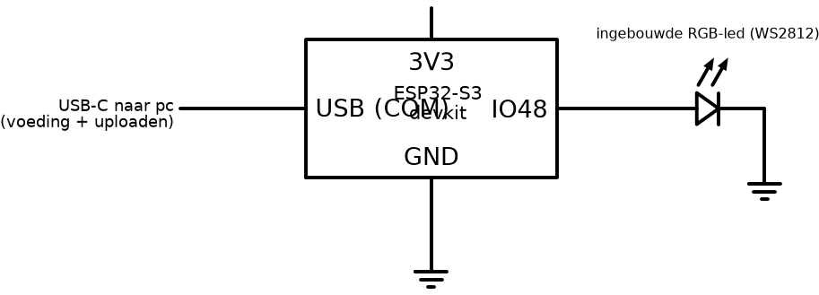

# Blink proof of concept

Het eenvoudigste microcontrollerprogramma. Het toont aan dat de programmeeromgeving, de compiler en de drivers juist geïnstalleerd zijn, dat uploaden lukt, dat de microcontroller werkt en dat de kloksnelheid klopt.

### hardware
Enkel de ESP32-S3 devkit met een USB-C-kabel. De ingebouwde RGB-led hangt aan **GPIO48** (op sommige klonen GPIO38: pas dan `PIN_RGB` aan in [board.h](../../board.h)).

### werking
[poc_blink.ino](poc_blink/poc_blink.ino) zet de led elke 500 ms aan of uit met `millis()` (niet-blokkerend, geen `delay`). Bij elke keer "aan" stuurt het programma een teller naar de seriële monitor.

### gebruiksaanwijzing
1. Sluit de devkit aan op de USB-C-poort met opdruk **COM** (zie [instructable stap 13](../../../instructable/readme.md)).
2. Upload: `.\upload.ps1 blink` vanuit de map `code`, of open de sketch in de Arduino IDE.
3. Open de seriële monitor op 115200 baud.

### resultaat
- [ ] de led knippert blauw, 1 keer per seconde
- [ ] 10 keer knipperen duurt 10 seconden (klok klopt)
- [ ] de seriële monitor toont `blink 1`, `blink 2`, ...
