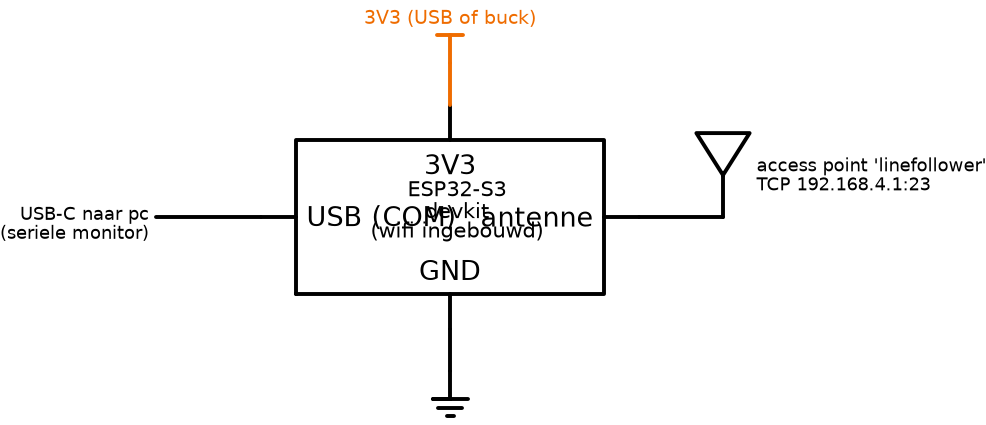

# draadloze communicatie proof of concept
minimale hard- en software waarmee aangetoond wordt dat duplex kan gecommuniceerd worden tussen de microcontroller en een smartphone of laptop, gebruik makend van een raw-TCP-terminal over wifi (Serial WiFi Terminal of PuTTY)

### configuratie

De ESP32-S3 maakt zijn eigen wifinetwerk (access point) **linefollower**. Wachtwoord: **lijnvolger2026** (`WIFI_WACHTWOORD` in [poc_wifi.ino](poc_wifi/poc_wifi.ino), minstens 8 tekens; verander het daar als je wil). Een TCP-server luistert op **192.168.4.1, poort 23**.

### opmerkingen
- Geen router nodig: werkt overal, ook op de wedstrijd.
- De sensoren hangen aan ADC1 en blijven dus bruikbaar terwijl wifi aan staat (ADC2 niet).

### gebruiksaanwijzing
1. Upload `poc_wifi` en open de seriële monitor (115200 baud).
2. Verbind de gsm met het netwerk **linefollower**.
3. Open de app "Serial WiFi Terminal" (Android) of PuTTY (type *Raw*) naar 192.168.4.1:23.
4. Typ iets op de gsm: het verschijnt in de seriële monitor. Typ iets in de monitor: het verschijnt op de gsm.

### resultaat
- [ ] gsm → robot
- [ ] robot → gsm
