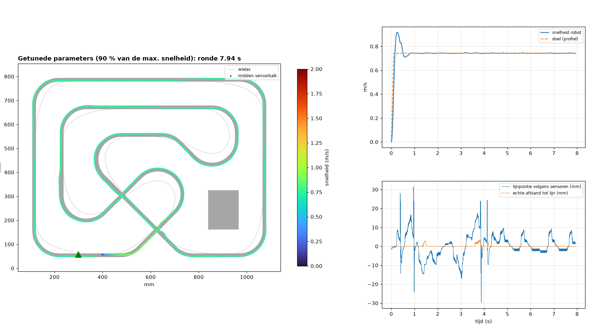

# Simulatie

De robot rijdt virtueel op **parcours 3**, met **exact dezelfde regelcode als de ESP32** (`code/lib/lf_core`).
Zo kunnen we PID en snelheidsprofiel afstellen en ontwerpkeuzes testen vóór de onderdelen er zijn.



## Hoe het werkt (software-in-the-loop)

| Deel | Wat | Bestand |
|---|---|---|
| Baan | parcours3.svg -> zwart/wit-raster van 0,5 mm | [baan.py](baan.py) |
| Sensoren | 8 x QRE1113, 9,525 mm uit elkaar, 98,7 mm voor de as, meetvlek r = 2 mm, ruis, elke sensor andere gevoeligheid | [sim.py](sim.py) |
| Regelaar | de firmwarecode zelf, gecompileerd tot `lf_sim.dll` en aangeroepen via ctypes | [lf_sim_api.cpp](lf_sim_api.cpp) |
| Robot | 2 DC-motoren (2,51 m/s onbelast @ 6 V, 0,8 N blokkeerkracht), massa + gewichtsverdeling uit de [tekening](../technische%20tekeningen/mechanisch/readme.md), grip mu = 0,9, zijdelings slippen | [sim.py](sim.py) |
| Encoders | 280 tellen per wieltoer, snelheid over 10 ms (zoals de firmware) | [sim.py](sim.py) |
| Tuner | 700 willekeurige parametersets + verfijnen, parallel; robuust: 3 runs met ruis en -6/0/+6 % motorverschil | [sim.py](sim.py) |
| Unit tests | 133 testen op sensorverwerking, parameters en regelaar | [test_core.cpp](test_core.cpp) |

## Gebruiken
Vereist: [uv](https://docs.astral.sh/uv/) (installeert zelf numpy, scipy, matplotlib, svgpathtools en de C++-compiler `ziglang`).
```
cd simulatie
uv run --no-project --with numpy,scipy,matplotlib,svgpathtools,ziglang python sim.py                 # 1 ronde
uv run --no-project --with numpy,scipy,matplotlib,svgpathtools,ziglang python sim.py set kp=0.03 vrecht=1.5
uv run --no-project --with numpy,scipy,matplotlib,svgpathtools,ziglang python sim.py tune            # ±5 min
uv run --no-project --with ziglang python -m ziglang c++ -std=c++17 -w -o test_core.exe test_core.cpp -I ../code/lib/lf_core/src
test_core.exe
```
Resultaat van de tuner: [resultaat_tune.md](resultaat_tune.md) - die `set`-commando's kan je zo op de robot typen.

## Wat de simulatie ons al leerde
1. **Bochten bepalen de rondetijd, niet de topsnelheid.** Parcours 3 is ±7,0 m (twee metingen: afgelegde weg van de sensor 6,97 m, lijnoppervlak/15 mm zonder startvak 6,7 m; de eerdere schatting van 7,8 m was te hoog) en zit vol bochten van r ≈ 100 mm. Daar is de grens √(mu·g·r) ≈ 0,94 m/s. Sneller kan enkel met meer grip (zachtere banden, zuigventilator) of door bochten te kennen (mapping, zie onder).
2. **Een P-regeling alleen haalt de bochten niet**: aan 1 m/s in r = 100 mm moeten de wielen 0,5 m/s verschillen. Met enkel P vraagt dat ±47 mm fout, meer dan de sensorbalk (±33 mm). Daarom zit er een I-term en een D-term in, en een remlogica op de afgeleide van de fout.
3. **Lijnpositie: zwaartepunt i.p.v. parabool.** De lijn (15 mm) is breder dan de sensorafstand (9,5 mm). Een parabool gaf tot 5,3 mm fout, het zwaartepunt 1,1 mm (unit test).
4. **Gewichtsverdeling**: met de caster op 34 mm stond maar 37 % van het gewicht op de aandrijfwielen (±3 m/s² grip). Caster naar 84 mm -> 73 %.
5. **Encodersnelheid** moet over meerdere cycli gemeten worden: 1 tel = 0,36 mm, bij 1 ms cyclus is dat 0,36 m/s per tel. De firmware middelt over 10 ms.

## Volgende stap (na de eerste ritten)
- Model ijken met echte metingen: `set debug on` geeft elke 20 ms positie, snelheden en duty. Motorconstante en grip aanpassen tot de simulatie de rit nadoet.
- **Mapping**: eerste ronde de bochten onthouden (encoderafstand), vanaf de tweede ronde op tijd remmen en langer boosten. De simulatie kan de winst eerst tonen.
