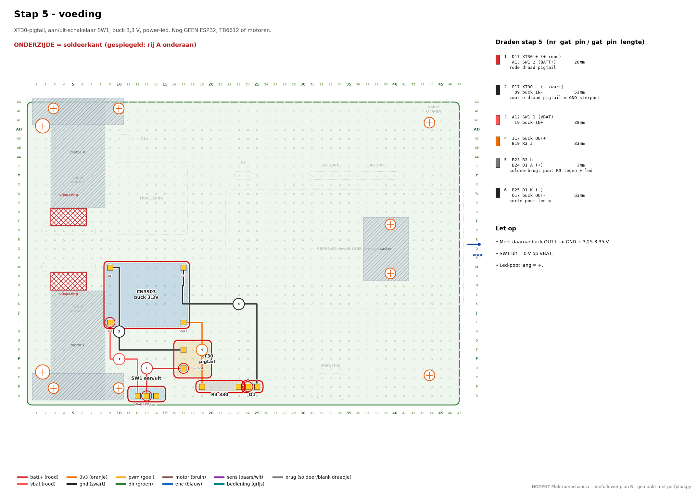
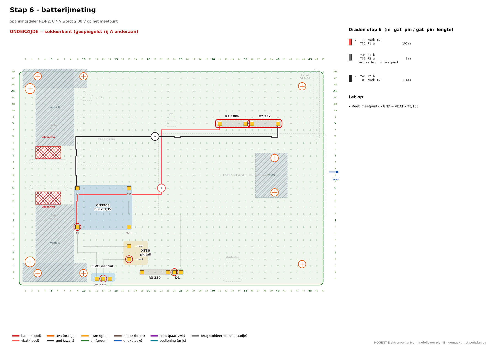
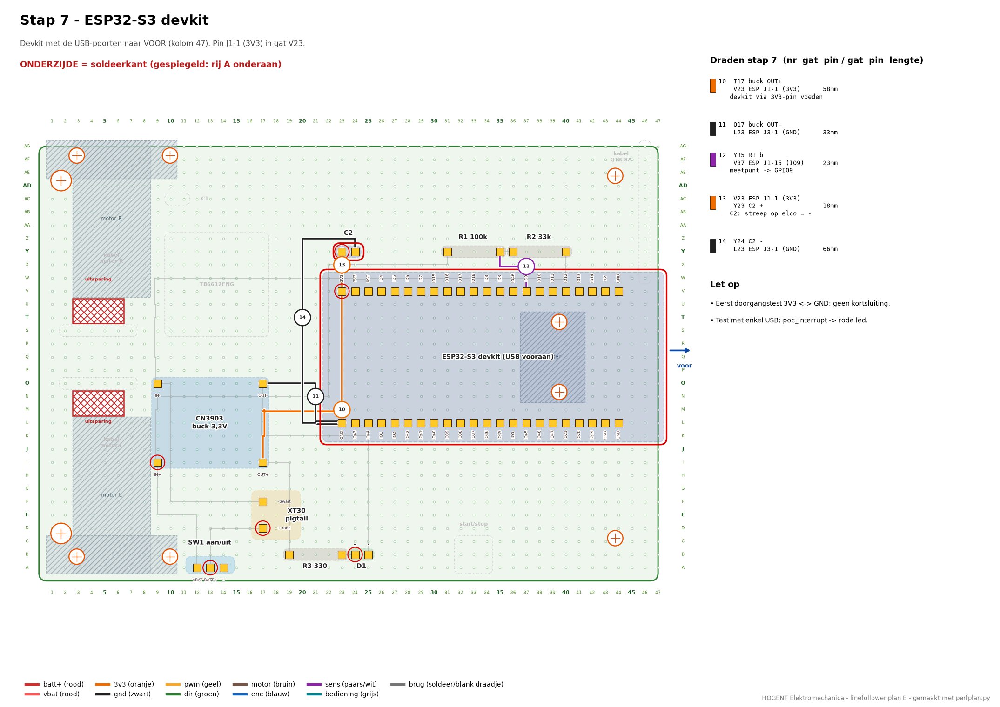
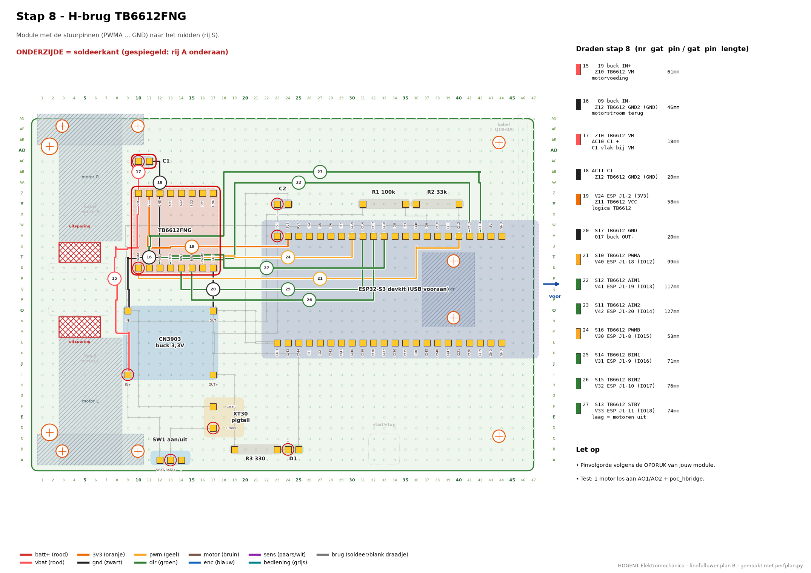
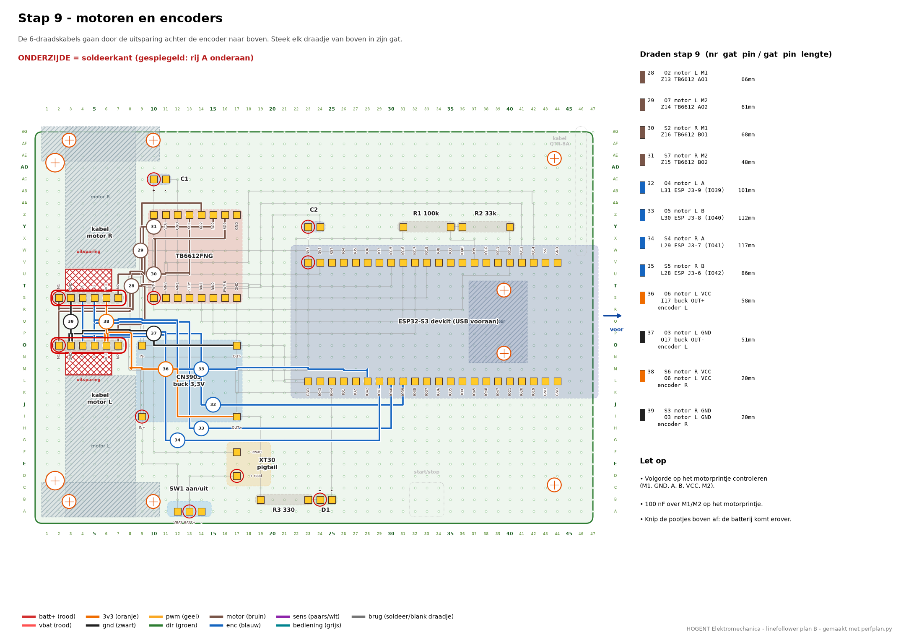
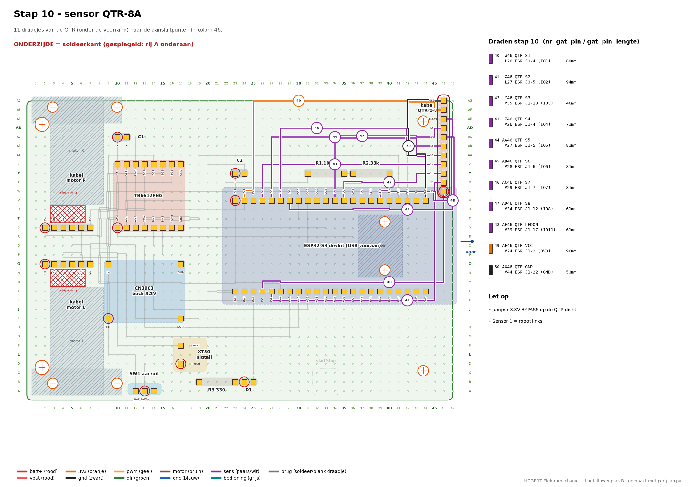
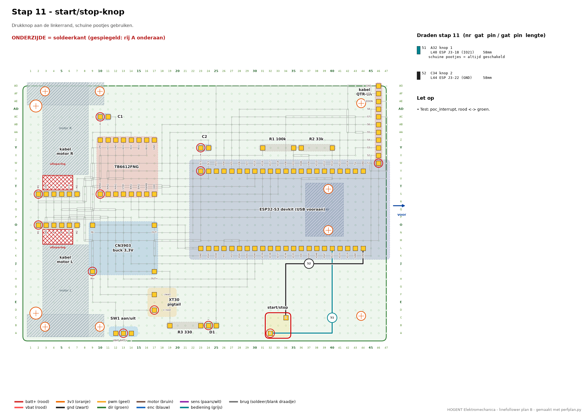

# Draadlijst - Linefollower - gaatjesprint

Automatisch gemaakt door `perfplan.py`. Plaatjes per stap: zie hieronder. Volledige PDF: [bekabelingsplan.pdf](bekabelingsplan.pdf).
Gat = rij (letter) + kolom (nummer), zoals op de randen van de tekening. Lengte = afgeknipte draad incl. 2× 5 mm strippen.

## Stap 5 - voeding

XT30-pigtail, aan/uit-schakelaar SW1, buck 3,3 V, power-led. Nog GEEN ESP32, TB6612 of motoren.

Plaatsen: SW1 aan/uit, XT30 pigtail, CN3903 buck 3,3V, R3 330, D1

| ✓ | nr | van | gat | naar | gat | kleur | lengte | opmerking |
|---|---|---|---|---|---|---|---|---|
| ☐ | 1 | XT30 + (+ rood) | **D17** | SW1 2 (BATT+) | **A13** | rood | 28 mm | rode draad pigtail |
| ☐ | 2 | XT30 - (- zwart) | **F17** | buck IN- | **O9** | zwart | 53 mm | zwarte draad pigtail = GND-sterpunt |
| ☐ | 3 | SW1 1 (VBAT) | **A12** | buck IN+ | **I9** | rood | 38 mm |  |
| ☐ | 4 | buck OUT+ | **I17** | R3 a | **B19** | oranje | 33 mm |  |
| ☐ | 5 | R3 b | **B23** | D1 A (+) | **B24** | soldeer/blank draadje | 3 mm | soldeerbrug: poot R3 tegen + led |
| ☐ | 6 | D1 K (-) | **B25** | buck OUT- | **O17** | zwart | 63 mm | korte poot led = - |

Let op:
- Meet daarna: buck OUT+ -> GND = 3,25-3,35 V.
- SW1 uit = 0 V op VBAT.
- Led-poot lang = +.

## Stap 6 - batterijmeting

Spanningsdeler R1/R2: 8,4 V wordt 2,08 V op het meetpunt.

Plaatsen: R1 100k, R2 33k

| ✓ | nr | van | gat | naar | gat | kleur | lengte | opmerking |
|---|---|---|---|---|---|---|---|---|
| ☐ | 7 | buck IN+ | **I9** | R1 a | **Y31** | rood | 107 mm |  |
| ☐ | 8 | R1 b | **Y35** | R2 a | **Y36** | soldeer/blank draadje | 3 mm | soldeerbrug = meetpunt |
| ☐ | 9 | R2 b | **Y40** | buck IN- | **O9** | zwart | 114 mm |  |

Let op:
- Meet: meetpunt -> GND = VBAT x 33/133.

## Stap 7 - ESP32-S3 devkit

Devkit met de USB-poorten naar VOOR (kolom 47). Pin J1-1 (3V3) in gat V23.

Plaatsen: ESP32-S3 devkit (USB vooraan), C2

| ✓ | nr | van | gat | naar | gat | kleur | lengte | opmerking |
|---|---|---|---|---|---|---|---|---|
| ☐ | 10 | buck OUT+ | **I17** | ESP J1-1 (3V3) | **V23** | oranje | 58 mm | devkit via 3V3-pin voeden |
| ☐ | 11 | buck OUT- | **O17** | ESP J3-1 (GND) | **L23** | zwart | 33 mm |  |
| ☐ | 12 | R1 b | **Y35** | ESP J1-15 (IO9) | **V37** | paars/wit | 23 mm | meetpunt -> GPIO9 |
| ☐ | 13 | ESP J1-1 (3V3) | **V23** | C2 + | **Y23** | oranje | 18 mm | C2: streep op elco = - |
| ☐ | 14 | C2 - | **Y24** | ESP J3-1 (GND) | **L23** | zwart | 66 mm |  |

Let op:
- Eerst doorgangstest 3V3 <-> GND: geen kortsluiting.
- Test met enkel USB: poc_interrupt -> rode led.

## Stap 8 - H-brug TB6612FNG

Module met de stuurpinnen (PWMA ... GND) naar het midden (rij S).

Plaatsen: TB6612FNG, C1

| ✓ | nr | van | gat | naar | gat | kleur | lengte | opmerking |
|---|---|---|---|---|---|---|---|---|
| ☐ | 15 | buck IN+ | **I9** | TB6612 VM | **Z10** | rood | 61 mm | motorvoeding |
| ☐ | 16 | buck IN- | **O9** | TB6612 GND2 (GND) | **Z12** | zwart | 46 mm | motorstroom terug |
| ☐ | 17 | TB6612 VM | **Z10** | C1 + | **AC10** | rood | 18 mm | C1 vlak bij VM |
| ☐ | 18 | C1 - | **AC11** | TB6612 GND2 (GND) | **Z12** | zwart | 20 mm |  |
| ☐ | 19 | ESP J1-2 (3V3) | **V24** | TB6612 VCC | **Z11** | oranje | 58 mm | logica TB6612 |
| ☐ | 20 | TB6612 GND | **S17** | buck OUT- | **O17** | zwart | 20 mm |  |
| ☐ | 21 | TB6612 PWMA | **S10** | ESP J1-18 (IO12) | **V40** | geel | 99 mm |  |
| ☐ | 22 | TB6612 AIN1 | **S12** | ESP J1-19 (IO13) | **V41** | groen | 117 mm |  |
| ☐ | 23 | TB6612 AIN2 | **S11** | ESP J1-20 (IO14) | **V42** | groen | 127 mm |  |
| ☐ | 24 | TB6612 PWMB | **S16** | ESP J1-8 (IO15) | **V30** | geel | 53 mm |  |
| ☐ | 25 | TB6612 BIN1 | **S14** | ESP J1-9 (IO16) | **V31** | groen | 71 mm |  |
| ☐ | 26 | TB6612 BIN2 | **S15** | ESP J1-10 (IO17) | **V32** | groen | 76 mm |  |
| ☐ | 27 | TB6612 STBY | **S13** | ESP J1-11 (IO18) | **V33** | groen | 74 mm | laag = motoren uit |

Let op:
- Pinvolgorde volgens de OPDRUK van jouw module.
- Test: 1 motor los aan AO1/AO2 + poc_hbridge.

## Stap 9 - motoren en encoders

De 6-draadskabels gaan door de uitsparing achter de encoder naar boven. Steek elk draadje van boven in zijn gat.

Plaatsen: kabel motor L, kabel motor R

| ✓ | nr | van | gat | naar | gat | kleur | lengte | opmerking |
|---|---|---|---|---|---|---|---|---|
| ☐ | 28 | motor L M1 | **O2** | TB6612 AO1 | **Z13** | bruin | 66 mm |  |
| ☐ | 29 | motor L M2 | **O7** | TB6612 AO2 | **Z14** | bruin | 61 mm |  |
| ☐ | 30 | motor R M1 | **S2** | TB6612 BO1 | **Z16** | bruin | 68 mm |  |
| ☐ | 31 | motor R M2 | **S7** | TB6612 BO2 | **Z15** | bruin | 48 mm |  |
| ☐ | 32 | motor L A | **O4** | ESP J3-9 (IO39) | **L31** | blauw | 101 mm |  |
| ☐ | 33 | motor L B | **O5** | ESP J3-8 (IO40) | **L30** | blauw | 112 mm |  |
| ☐ | 34 | motor R A | **S4** | ESP J3-7 (IO41) | **L29** | blauw | 117 mm |  |
| ☐ | 35 | motor R B | **S5** | ESP J3-6 (IO42) | **L28** | blauw | 86 mm |  |
| ☐ | 36 | motor L VCC | **O6** | buck OUT+ | **I17** | oranje | 58 mm | encoder L |
| ☐ | 37 | motor L GND | **O3** | buck OUT- | **O17** | zwart | 51 mm | encoder L |
| ☐ | 38 | motor R VCC | **S6** | motor L VCC | **O6** | oranje | 20 mm | encoder R |
| ☐ | 39 | motor R GND | **S3** | motor L GND | **O3** | zwart | 20 mm | encoder R |

Let op:
- Volgorde op het motorprintje controleren
(M1, GND, A, B, VCC, M2).
- 100 nF over M1/M2 op het motorprintje.
- Knip de pootjes boven af: de batterij komt erover.

## Stap 10 - sensor QTR-8A

11 draadjes van de QTR (onder de voorrand) naar de aansluitpunten in kolom 46.

Plaatsen: kabel QTR-8A

| ✓ | nr | van | gat | naar | gat | kleur | lengte | opmerking |
|---|---|---|---|---|---|---|---|---|
| ☐ | 40 | QTR S1 | **W46** | ESP J3-4 (IO1) | **L26** | paars/wit | 89 mm |  |
| ☐ | 41 | QTR S2 | **X46** | ESP J3-5 (IO2) | **L27** | paars/wit | 94 mm |  |
| ☐ | 42 | QTR S3 | **Y46** | ESP J1-13 (IO3) | **V35** | paars/wit | 46 mm |  |
| ☐ | 43 | QTR S4 | **Z46** | ESP J1-4 (IO4) | **V26** | paars/wit | 71 mm |  |
| ☐ | 44 | QTR S5 | **AA46** | ESP J1-5 (IO5) | **V27** | paars/wit | 81 mm |  |
| ☐ | 45 | QTR S6 | **AB46** | ESP J1-6 (IO6) | **V28** | paars/wit | 81 mm |  |
| ☐ | 46 | QTR S7 | **AC46** | ESP J1-7 (IO7) | **V29** | paars/wit | 81 mm |  |
| ☐ | 47 | QTR S8 | **AD46** | ESP J1-12 (IO8) | **V34** | paars/wit | 61 mm |  |
| ☐ | 48 | QTR LEDON | **AE46** | ESP J1-17 (IO11) | **V39** | paars/wit | 61 mm |  |
| ☐ | 49 | QTR VCC | **AF46** | ESP J1-2 (3V3) | **V24** | oranje | 96 mm |  |
| ☐ | 50 | QTR GND | **AG46** | ESP J1-22 (GND) | **V44** | zwart | 53 mm |  |

Let op:
- Jumper 3.3V BYPASS op de QTR dicht.
- Sensor 1 = robot links.

## Stap 11 - start/stop-knop

Drukknop aan de linkerrand, schuine pootjes gebruiken.

Plaatsen: start/stop

| ✓ | nr | van | gat | naar | gat | kleur | lengte | opmerking |
|---|---|---|---|---|---|---|---|---|
| ☐ | 51 | knop 1 | **A32** | ESP J3-18 (IO21) | **L40** | grijs | 58 mm | schuine pootjes = altijd geschakeld |
| ☐ | 52 | knop 2 | **C34** | ESP J3-22 (GND) | **L44** | zwart | 58 mm |  |

Let op:
- Test: poc_interrupt, rood <-> groen.
