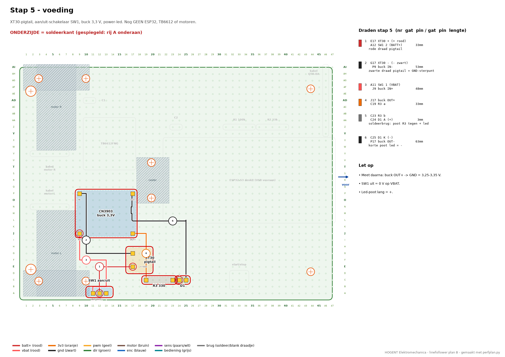
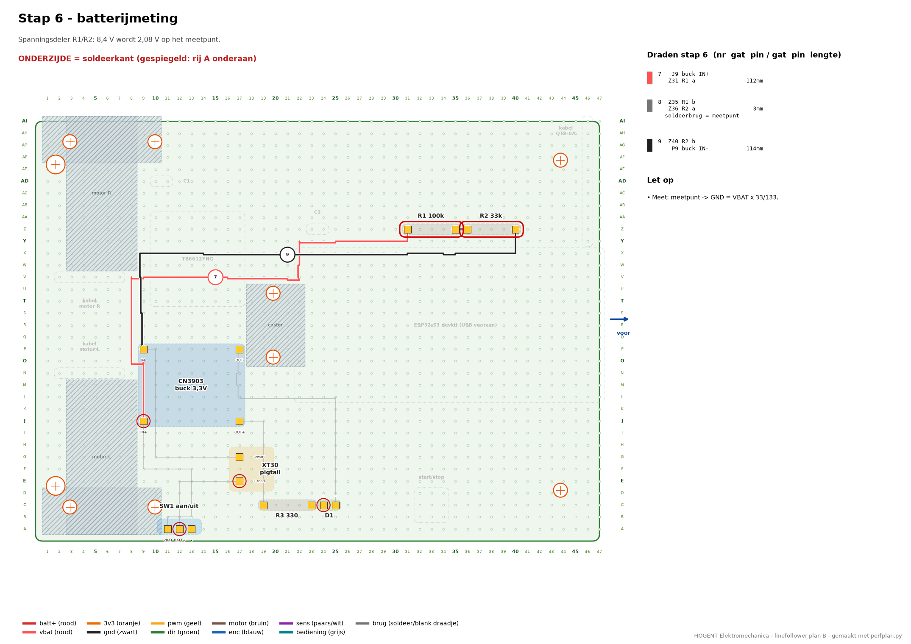
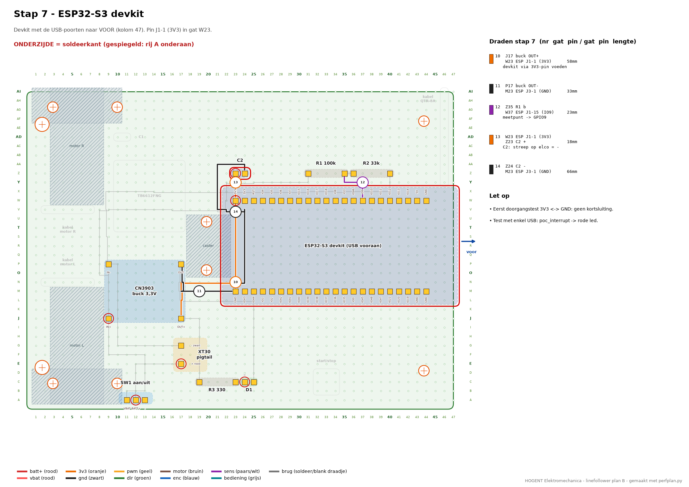
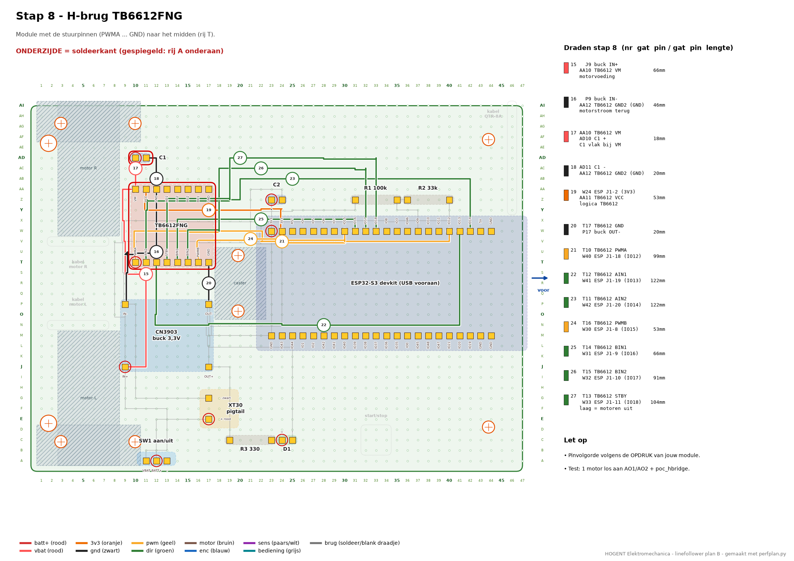
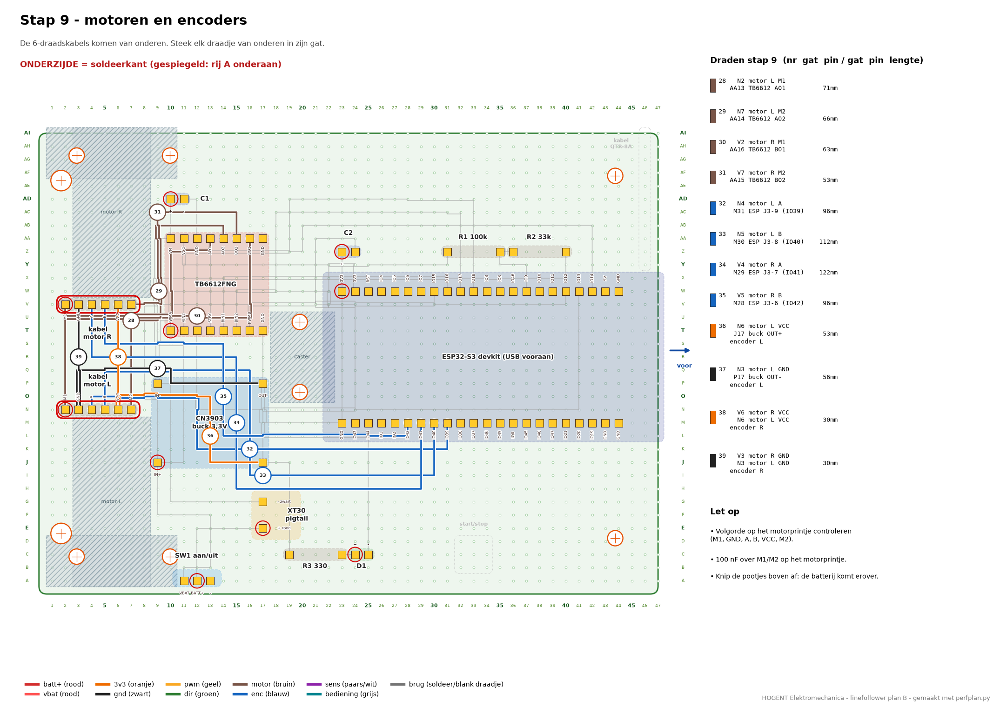
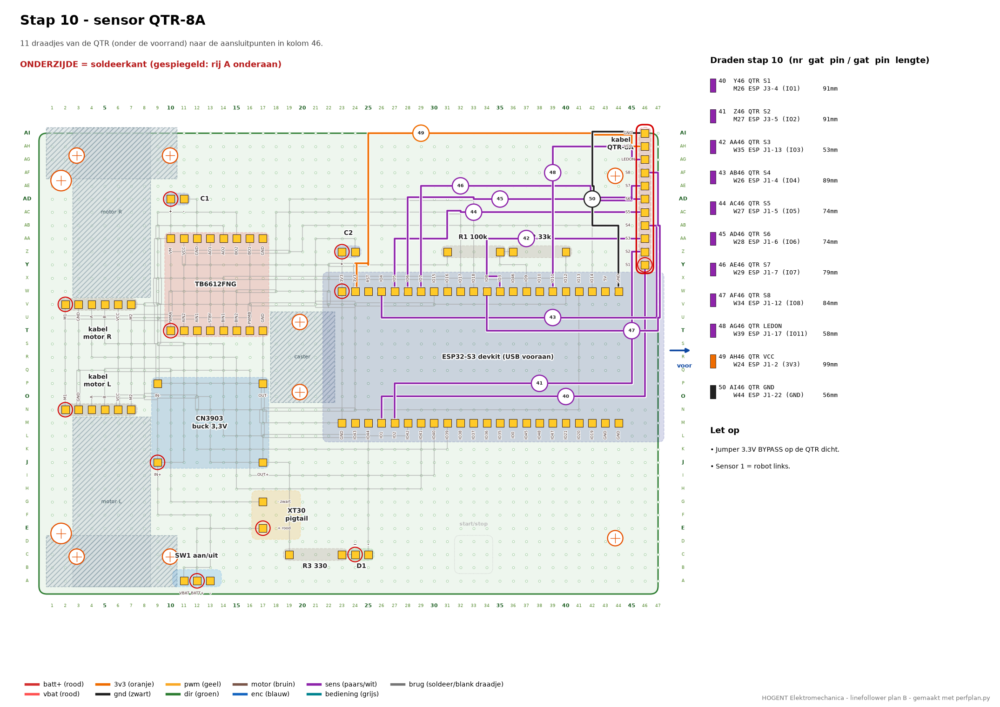
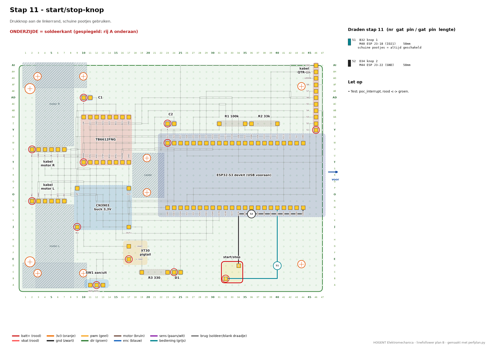

# Draadlijst - Linefollower - gaatjesprint

Automatisch gemaakt door `perfplan.py`. Plaatjes per stap: zie hieronder. Volledige PDF: [bekabelingsplan.pdf](bekabelingsplan.pdf).
Gat = rij (letter) + kolom (nummer), zoals op de randen van de tekening. Lengte = afgeknipte draad incl. 2× 5 mm strippen.

## Stap 5 - voeding

XT30-pigtail, aan/uit-schakelaar SW1, buck 3,3 V, power-led. Nog GEEN ESP32, TB6612 of motoren.

Plaatsen: SW1 aan/uit, XT30 pigtail, CN3903 buck 3,3V, R3 330, D1

| ✓ | nr | van | gat | naar | gat | kleur | lengte | opmerking |
|---|---|---|---|---|---|---|---|---|
| ☐ | 1 | XT30 + (+ rood) | **E17** | SW1 2 (BATT+) | **A12** | rood | 33 mm | rode draad pigtail |
| ☐ | 2 | XT30 - (- zwart) | **G17** | buck IN- | **P9** | zwart | 53 mm | zwarte draad pigtail = GND-sterpunt |
| ☐ | 3 | SW1 1 (VBAT) | **A11** | buck IN+ | **J9** | rood | 48 mm |  |
| ☐ | 4 | buck OUT+ | **J17** | R3 a | **C19** | oranje | 33 mm |  |
| ☐ | 5 | R3 b | **C23** | D1 A (+) | **C24** | soldeer/blank draadje | 3 mm | soldeerbrug: poot R3 tegen + led |
| ☐ | 6 | D1 K (-) | **C25** | buck OUT- | **P17** | zwart | 63 mm | korte poot led = - |

Let op:
- Meet daarna: buck OUT+ -> GND = 3,25-3,35 V.
- SW1 uit = 0 V op VBAT.
- Led-poot lang = +.

## Stap 6 - batterijmeting

Spanningsdeler R1/R2: 8,4 V wordt 2,08 V op het meetpunt.

Plaatsen: R1 100k, R2 33k

| ✓ | nr | van | gat | naar | gat | kleur | lengte | opmerking |
|---|---|---|---|---|---|---|---|---|
| ☐ | 7 | buck IN+ | **J9** | R1 a | **Z31** | rood | 112 mm |  |
| ☐ | 8 | R1 b | **Z35** | R2 a | **Z36** | soldeer/blank draadje | 3 mm | soldeerbrug = meetpunt |
| ☐ | 9 | R2 b | **Z40** | buck IN- | **P9** | zwart | 114 mm |  |

Let op:
- Meet: meetpunt -> GND = VBAT x 33/133.

## Stap 7 - ESP32-S3 devkit

Devkit met de USB-poorten naar VOOR (kolom 47). Pin J1-1 (3V3) in gat W23.

Plaatsen: ESP32-S3 devkit (USB vooraan), C2

| ✓ | nr | van | gat | naar | gat | kleur | lengte | opmerking |
|---|---|---|---|---|---|---|---|---|
| ☐ | 10 | buck OUT+ | **J17** | ESP J1-1 (3V3) | **W23** | oranje | 58 mm | devkit via 3V3-pin voeden |
| ☐ | 11 | buck OUT- | **P17** | ESP J3-1 (GND) | **M23** | zwart | 33 mm |  |
| ☐ | 12 | R1 b | **Z35** | ESP J1-15 (IO9) | **W37** | paars/wit | 23 mm | meetpunt -> GPIO9 |
| ☐ | 13 | ESP J1-1 (3V3) | **W23** | C2 + | **Z23** | oranje | 18 mm | C2: streep op elco = - |
| ☐ | 14 | C2 - | **Z24** | ESP J3-1 (GND) | **M23** | zwart | 66 mm |  |

Let op:
- Eerst doorgangstest 3V3 <-> GND: geen kortsluiting.
- Test met enkel USB: poc_interrupt -> rode led.

## Stap 8 - H-brug TB6612FNG

Module met de stuurpinnen (PWMA ... GND) naar het midden (rij T).

Plaatsen: TB6612FNG, C1

| ✓ | nr | van | gat | naar | gat | kleur | lengte | opmerking |
|---|---|---|---|---|---|---|---|---|
| ☐ | 15 | buck IN+ | **J9** | TB6612 VM | **AA10** | rood | 66 mm | motorvoeding |
| ☐ | 16 | buck IN- | **P9** | TB6612 GND2 (GND) | **AA12** | zwart | 46 mm | motorstroom terug |
| ☐ | 17 | TB6612 VM | **AA10** | C1 + | **AD10** | rood | 18 mm | C1 vlak bij VM |
| ☐ | 18 | C1 - | **AD11** | TB6612 GND2 (GND) | **AA12** | zwart | 20 mm |  |
| ☐ | 19 | ESP J1-2 (3V3) | **W24** | TB6612 VCC | **AA11** | oranje | 53 mm | logica TB6612 |
| ☐ | 20 | TB6612 GND | **T17** | buck OUT- | **P17** | zwart | 20 mm |  |
| ☐ | 21 | TB6612 PWMA | **T10** | ESP J1-18 (IO12) | **W40** | geel | 99 mm |  |
| ☐ | 22 | TB6612 AIN1 | **T12** | ESP J1-19 (IO13) | **W41** | groen | 122 mm |  |
| ☐ | 23 | TB6612 AIN2 | **T11** | ESP J1-20 (IO14) | **W42** | groen | 122 mm |  |
| ☐ | 24 | TB6612 PWMB | **T16** | ESP J1-8 (IO15) | **W30** | geel | 53 mm |  |
| ☐ | 25 | TB6612 BIN1 | **T14** | ESP J1-9 (IO16) | **W31** | groen | 66 mm |  |
| ☐ | 26 | TB6612 BIN2 | **T15** | ESP J1-10 (IO17) | **W32** | groen | 91 mm |  |
| ☐ | 27 | TB6612 STBY | **T13** | ESP J1-11 (IO18) | **W33** | groen | 104 mm | laag = motoren uit |

Let op:
- Pinvolgorde volgens de OPDRUK van jouw module.
- Test: 1 motor los aan AO1/AO2 + poc_hbridge.

## Stap 9 - motoren en encoders

De 6-draadskabels komen van onderen. Steek elk draadje van onderen in zijn gat.

Plaatsen: kabel motor L, kabel motor R

| ✓ | nr | van | gat | naar | gat | kleur | lengte | opmerking |
|---|---|---|---|---|---|---|---|---|
| ☐ | 28 | motor L M1 | **N2** | TB6612 AO1 | **AA13** | bruin | 71 mm |  |
| ☐ | 29 | motor L M2 | **N7** | TB6612 AO2 | **AA14** | bruin | 66 mm |  |
| ☐ | 30 | motor R M1 | **V2** | TB6612 BO1 | **AA16** | bruin | 63 mm |  |
| ☐ | 31 | motor R M2 | **V7** | TB6612 BO2 | **AA15** | bruin | 53 mm |  |
| ☐ | 32 | motor L A | **N4** | ESP J3-9 (IO39) | **M31** | blauw | 96 mm |  |
| ☐ | 33 | motor L B | **N5** | ESP J3-8 (IO40) | **M30** | blauw | 112 mm |  |
| ☐ | 34 | motor R A | **V4** | ESP J3-7 (IO41) | **M29** | blauw | 122 mm |  |
| ☐ | 35 | motor R B | **V5** | ESP J3-6 (IO42) | **M28** | blauw | 96 mm |  |
| ☐ | 36 | motor L VCC | **N6** | buck OUT+ | **J17** | oranje | 53 mm | encoder L |
| ☐ | 37 | motor L GND | **N3** | buck OUT- | **P17** | zwart | 56 mm | encoder L |
| ☐ | 38 | motor R VCC | **V6** | motor L VCC | **N6** | oranje | 30 mm | encoder R |
| ☐ | 39 | motor R GND | **V3** | motor L GND | **N3** | zwart | 30 mm | encoder R |

Let op:
- Volgorde op het motorprintje controleren
(M1, GND, A, B, VCC, M2).
- 100 nF over M1/M2 op het motorprintje.
- Knip de pootjes boven af: de batterij komt erover.

## Stap 10 - sensor QTR-8A

11 draadjes van de QTR (onder de voorrand) naar de aansluitpunten in kolom 46.

Plaatsen: kabel QTR-8A

| ✓ | nr | van | gat | naar | gat | kleur | lengte | opmerking |
|---|---|---|---|---|---|---|---|---|
| ☐ | 40 | QTR S1 | **Y46** | ESP J3-4 (IO1) | **M26** | paars/wit | 91 mm |  |
| ☐ | 41 | QTR S2 | **Z46** | ESP J3-5 (IO2) | **M27** | paars/wit | 91 mm |  |
| ☐ | 42 | QTR S3 | **AA46** | ESP J1-13 (IO3) | **W35** | paars/wit | 53 mm |  |
| ☐ | 43 | QTR S4 | **AB46** | ESP J1-4 (IO4) | **W26** | paars/wit | 89 mm |  |
| ☐ | 44 | QTR S5 | **AC46** | ESP J1-5 (IO5) | **W27** | paars/wit | 74 mm |  |
| ☐ | 45 | QTR S6 | **AD46** | ESP J1-6 (IO6) | **W28** | paars/wit | 74 mm |  |
| ☐ | 46 | QTR S7 | **AE46** | ESP J1-7 (IO7) | **W29** | paars/wit | 79 mm |  |
| ☐ | 47 | QTR S8 | **AF46** | ESP J1-12 (IO8) | **W34** | paars/wit | 84 mm |  |
| ☐ | 48 | QTR LEDON | **AG46** | ESP J1-17 (IO11) | **W39** | paars/wit | 58 mm |  |
| ☐ | 49 | QTR VCC | **AH46** | ESP J1-2 (3V3) | **W24** | oranje | 99 mm |  |
| ☐ | 50 | QTR GND | **AI46** | ESP J1-22 (GND) | **W44** | zwart | 56 mm |  |

Let op:
- Jumper 3.3V BYPASS op de QTR dicht.
- Sensor 1 = robot links.

## Stap 11 - start/stop-knop

Drukknop aan de linkerrand, schuine pootjes gebruiken.

Plaatsen: start/stop

| ✓ | nr | van | gat | naar | gat | kleur | lengte | opmerking |
|---|---|---|---|---|---|---|---|---|
| ☐ | 51 | knop 1 | **B32** | ESP J3-18 (IO21) | **M40** | grijs | 58 mm | schuine pootjes = altijd geschakeld |
| ☐ | 52 | knop 2 | **D34** | ESP J3-22 (GND) | **M44** | zwart | 58 mm |  |

Let op:
- Test: poc_interrupt, rood <-> groen.
