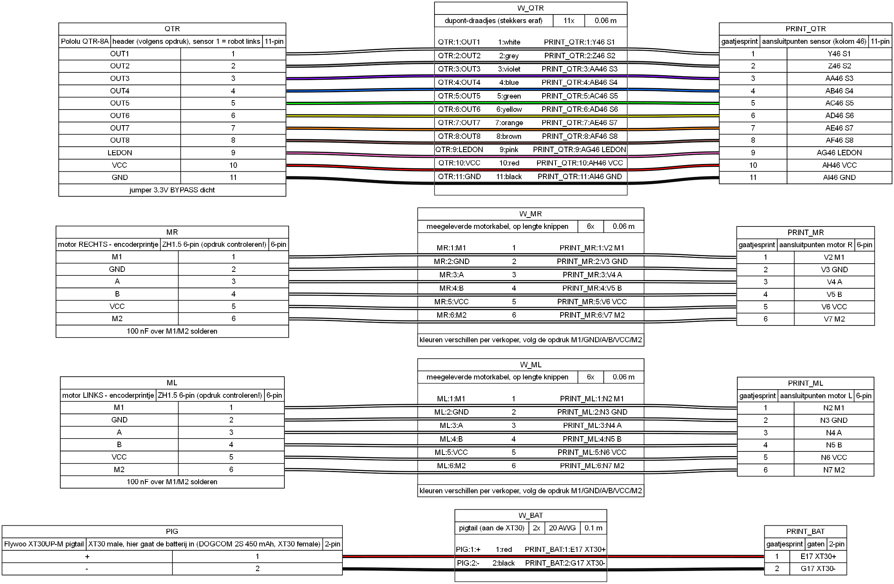

# Kabels

Alles wat niet op de gaatjesprint zelf ligt: de batterij-pigtail, de 2 motorkabels (motor + encoder) en de 11 draadjes van de sensor. De gaten (E17, N2, Y46, ...) zijn dezelfde als in het [bekabelingsplan](../bekabelingsplan.pdf).



| Bestand | Inhoud |
|---|---|
| [kabels.yml](kabels.yml) | beschrijving van de kabels (bron) |
| [kabels.png](kabels.png) / [kabels.svg](kabels.svg) | tekening |
| [kabels.html](kabels.html) | tekening + stuklijst samen |
| [kabels.bom.tsv](kabels.bom.tsv) | stuklijst van de kabels |

Gemaakt met [WireViz](https://github.com/wireviz/WireViz) + [Graphviz](https://graphviz.org):
```
wireviz kabels.yml
```
