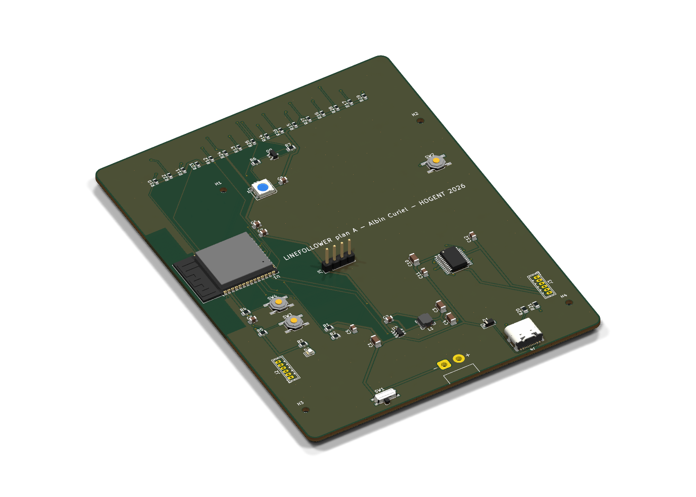
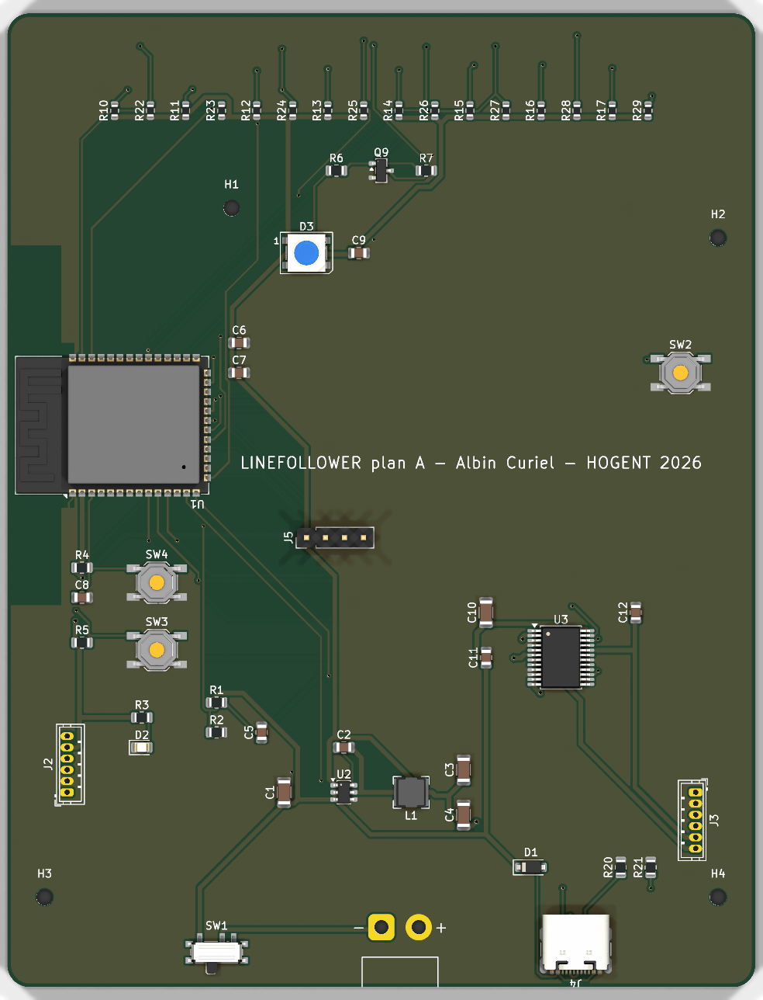

# Plan A: eigen print (KiCad 10)

Volledige linefollower op één print van **100 × 130 mm** met losse SMD-onderdelen, zonder breakoutmodules. Zelfde pinverdeling als plan B ([board.h](../../../code/board.h)), dus dezelfde firmware.

| Bestand | Inhoud |
|---|---|
| `linefollower_planA.kicad_pro` | het project: open dit in KiCad |
| `linefollower_planA.kicad_sch` | schema (ERC: 0 fouten) → [pdf](../elektrisch_schema_planA.pdf) |
| `linefollower_planA.kicad_pcb` | print: 2 lagen, volledig gerouteerd (765 sporen), GND-vlak op beide lagen → [pdf boven](../pcb_planA.pdf), [pdf onder](../pcb_planA_onderkant.pdf) |
| [gerbers_planA.zip](gerbers_planA.zip) | productiebestanden (gerbers + boorbestand), klaar om te uploaden bij JLCPCB/PCBWay |
| [drc_rapport.txt](drc_rapport.txt) | ontwerpcontrole: 0 fouten, 0 open verbindingen |
| [bom_planA.csv](bom_planA.csv) | onderdelenlijst met package per onderdeel (uit het schema) |
| `bouw_pcb.py` | bouwt de print uit de netlijst: plaatsing van elk onderdeel, omtrek, montagegaten, GND-vlakken |
| `route_pcb.py` | routeert de sporen met Freerouting (voeding en motoren 0,6 mm, signalen 0,25 mm) |
| `planA_netlijst.xml` | netlijst uit het schema (invoer voor `bouw_pcb.py`) |



| Bovenkant | Onderkant (sensoren) |
|---|---|
|  |  |

## Blokken

| Blok | Onderdelen | Opmerking |
|---|---|---|
| Voeding | J1 XT30, SW1 aan/uit, U2 **AP63203WU** (3,3 V, 2 A, TSOT-23-6) + L1 6,8 µH, C1–C4 | buck van 3,8–32 V naar 3,3 V |
| USB | J4 USB-C (USB4105), R20/R21 5,1 kΩ (CC), D1 **B5819W** | USB voedt via D1 de VBAT-lijn. De diode spert zodra de batterij aan staat (8,4 V > 5 V): **USB en batterij tegelijk is hier veilig**, het probleem van plan B is opgelost |
| Microcontroller | U1 **ESP32-S3-WROOM-1-N16R8**, C6/C7, RESET (SW4 + R4/C8), BOOT (SW3 + R5) | antenne over de linkerrand, geen koper eronder; native USB op GPIO19/20 |
| Sensoren | Q1–Q8 **QRE1113GR** (onderkant, steek 9,5 mm), R10–R17 100 Ω (IR-led), R22–R29 47 kΩ (pull-up), Q9 **AO3400A** (LEDON) | zelfde schakeling als de QTR-8A; GPIO1–8, LEDON = GPIO11 |
| Motorsturing | U3 **TB6612FNG** (SSOP-24), C10–C12, J2/J3 JST-ZH 6-pins naar de N20-motoren | GPIO12–18, encoders 39–42 |
| Bediening | SW2 start/stop (GPIO21), D2 power-led, D3 **WS2812B** statusled (GPIO48), J5 UART-debug | |
| Batterijmeting | R1 10 kΩ / R2 5,1 kΩ + C5 100 nF | GPIO9 |

## Ontwerpregels
Spoor/afstand 0,2 mm, via 0,6/0,3 mm (standaard bij JLCPCB/PCBWay, 2 lagen). Voeding- en motornetten 0,6 mm (netklasse *Voeding*). Alle passieve onderdelen 0805 (handsolderen) behalve de sensorweerstanden (0603, plaats).

## Opnieuw opbouwen
```
kicad-cli sch export netlist --format kicadxml -o planA_netlijst.xml linefollower_planA.kicad_sch
"<KiCad>\bin\python.exe" bouw_pcb.py planA_netlijst.xml
"<KiCad>\bin\python.exe" route_pcb.py <pad naar freerouting-1.9.0.jar>
kicad-cli pcb drc linefollower_planA.kicad_pcb
kicad-cli pcb export gerbers -o gerbers linefollower_planA.kicad_pcb
```

## Status
- Schema: klaar, ERC 0 fouten.
- Print: alle onderdelen geplaatst en gerouteerd met Freerouting 1.9.0, GND-vlakken met volle padverbinding.
- DRC: **0 fouten, 0 open verbindingen**. Enkel 3 waarschuwingen: de opdruk van de XT30 steekt over de achterrand (de stekker steekt bewust uit).
- Gerbers + boorbestand: klaar ([gerbers_planA.zip](gerbers_planA.zip)).
- Plan A wordt enkel ontworpen, niet besteld (zie [ontwerpkeuzes](../../../ontwerpkeuzes/onderdelenkeuze.md)).
