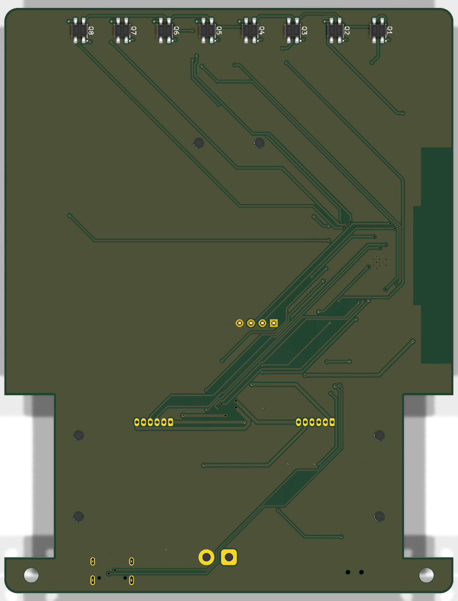

# Plan A: eigen print (KiCad 10)

Volledige linefollower op één print van **100 × 130 mm** met losse SMD-onderdelen, zonder breakoutmodules. De print is tegelijk het chassis: motoren, ball caster en spoiler worden er rechtstreeks op geschroefd. Zelfde pinverdeling als plan B ([board.h](../../../code/board.h)), dus dezelfde firmware.

Plan A is ontworpen, niet besteld of gesoldeerd.


| Bovenkant | Onderkant (sensoren) |
|---|---|
|  |  |

## Bestanden

| Bestand | Inhoud |
|---|---|
| `linefollower_planA.kicad_pro` | het project: open dit in KiCad |
| `linefollower_planA.kicad_sch` | schema (ERC: 0 fouten) → [pdf](../elektrisch_schema_planA.pdf) |
| `linefollower_planA.kicad_pcb` | print, 2 lagen, volledig gerouteerd → [pdf boven](../pcb_planA.pdf), [pdf onder](../pcb_planA_onderkant.pdf) |
| [gerbers_planA.zip](gerbers_planA.zip) | productiebestanden (gerbers + boorbestand) voor JLCPCB/PCBWay |
| [drc_rapport.txt](drc_rapport.txt) | ontwerpcontrole: 0 fouten, 0 open verbindingen |
| [bom_planA.csv](bom_planA.csv) | onderdelenlijst met package per onderdeel (uit het schema); met prijzen in de [BOM](../../../bill%20of%20materials/readme.md) |
| [tekening_planA.pdf](../../mechanisch/tekening_planA.pdf) | mechanische maattekening: omtrek, uitsparingen, boorgaten |
| `planA_maten.py` | alle maten van de print (omtrek, uitsparingen, boorgaten) |
| `bouw_pcb.py` | bouwt de print uit de netlijst: plaatsing van elk onderdeel, omtrek, gaten, GND-vlakken |
| `route_pcb.py` | netklassen + routeren met Freerouting |
| `maattekening.py` | maakt de maattekening |

## Blokken

| Blok | Onderdelen | Opmerking |
|---|---|---|
| Voeding | J1 XT30, **Q10 AO3401A** + R8 + SW1, U2 **AP63203WU** (3,3 V, 2 A) + L1 6,8 µH, C1–C4 | aan/uit: de schuifschakelaar SW1 stuurt enkel de gate van de P-MOSFET Q10. De batterijstroom loopt door de MOSFET (4 A), niet door de kleine schakelaar (0,3 A) |
| USB | J4 USB-C, R20/R21 5,1 kΩ (CC), D1 **B5819W** | USB voedt via D1 de VBAT-lijn. De diode spert zodra de batterij aan staat (8,4 V > 5 V): **USB en batterij tegelijk is hier veilig** |
| Microcontroller | U1 **ESP32-S3-WROOM-1-N16R8**, C6/C7, RESET (SW4 + R4/C8), BOOT (SW3 + R5), J5 UART | antenne over de linkerrand, geen koper eronder. Kristal en flash zitten in de module. Programmeren via de ingebouwde USB (GPIO19/20), geen ISP-pinnen nodig; UART op J5 als reserve |
| Sensoren | Q1–Q8 **QRE1113GR** (onderkant), R10–R17 100 Ω (IR-led), R22–R29 47 kΩ (pull-up), Q9 **AO3400A** (LEDON) | zelfde schakeling als de QTR-8A; GPIO1–8 (ADC1), LEDON = GPIO11 |
| Motorsturing | U3 **TB6612FNG** (SSOP-24), C10–C12, J2/J3 JST-ZH 6-pins | hardware-PWM op GPIO12/15, richting 13/14 en 16/17, STBY 18, encoders 39–42. VM = batterij, VCC = 3,3 V |
| Bediening | SW2 start/stop (GPIO21, interrupt), D2 power-led, D3 **WS2812B** statusled (GPIO48) | |
| Batterijmeting | R1 10 kΩ / R2 5,1 kΩ + C5 100 nF | GPIO9 |

## Checklist uit de cursus

### Schema
| Punt | Hoe opgelost |
|---|---|
| aansluiting batterij | J1 XT30 (haaks, op de achterrand) |
| voltage regulator + afvlak- en ontstoorcondensatoren | U2 AP63203 met C1 (ingang 10 µF), C2 (bootstrap), L1, C3/C4 (uitgang 2 × 22 µF) |
| indicator-led | D2 + R3 op 3,3 V (power), D3 RGB (status) |
| µC: ontstoorcondensatoren | C6 10 µF + C7 100 nF vlak naast de 3V3-pin |
| µC: kristal | in de module ingebouwd |
| usb-connector | J4 met CC-weerstanden; D+/D− rechtstreeks naar GPIO20/19 |
| start/stop-knop (interrupt) | SW2 op GPIO21 |
| resetknop | SW4 op EN met R4/C8 (RC-vertraging) |
| isp-pinnen | niet nodig: de ESP32-S3 programmeert via USB; BOOT-knop SW3 + UART J5 als noodoplossing |
| ongebruikte pinnen | met een no-connect-vlag in het schema; GPIO35–37 blijven vrij (bezet door het PSRAM van de N16R8) |
| communicatie | wifi zit in de module: geen rx/tx-kruising, geen level shifter |
| H-brug: logische en vermogenspanning | VCC = 3,3 V, VM = VBAT met C10 10 µF + C11 100 nF |
| H-brug: PWM- en richtingspinnen, connectoren | zie blokken; J2/J3 dragen motor én encoder |
| sensoren: weerstanden | 100 Ω per IR-led (±20 mA op 3,3 V), 47 kΩ pull-up per fototransistor |
| bevestigingsgaten | 4 × motorbeugel, 2 × caster, 2 × spoiler ([maattekening](../../mechanisch/tekening_planA.pdf)) |
| BOM aangepast naar plan A, leverancier en package per onderdeel | [BOM plan A](../../../bill%20of%20materials/readme.md) |
| ERC uitgevoerd | 0 fouten. De resterende waarschuwingen zeggen enkel dat de standaardbibliotheken van KiCad niet in de projectmap staan |

### Print
| Punt | Hoe opgelost |
|---|---|
| korte, dikke banen tussen voeding, H-brug en motoren | XT30, Q10, U2 en U3 liggen achteraan bij elkaar, tussen de motoren |
| regulator en condensatoren tegen elkaar | C1, C2, L1, C3, C4 rond U2 |
| µC en ontstoorcondensatoren tegen elkaar | C6/C7 naast U1 |
| usb-connector op de rand, kabel van de print weg | J4 op de achterrand |
| denk 3-dimensionaal | motoren, caster en sensoren aan de onderkant; hoge onderdelen (XT30, USB, stekkers) buiten de motorzone |
| sensoren vooraan, onderkant, loodrecht op de rijrichting | Q1–Q8 op 5 mm van de voorrand, 99 mm voor de wielas |
| motoren achteraan, gewichtsverdeling | wielas op 26 mm van de achterrand, batterij erboven |
| niet breder dan nodig | wielen in uitsparingen: de robot is 100 mm breed (chronobrug 120 mm) |
| analoog en digitaal gescheiden | sensoren vooraan, vermogen (motoren, buck) achteraan |
| groundplane | GND-vlak op beide lagen, met volle padverbinding; uitsparing onder de antenne |
| DRC uitgevoerd | 0 fouten, 0 open verbindingen. 3 waarschuwingen: de opdruk van de XT30 steekt over de achterrand (de stekker steekt bewust uit) |

### Spoorbreedtes

| Netklasse | Netten | Breedte | Stroom |
|---|---|---|---|
| Batterij | BATT+ | 1,0 mm | tot ±1,5 A |
| Vermogen | VBAT, motoren, schakelknoop buck | 0,6 mm | motor: 0,55 A bij blokkeren |
| Voeding | +3V3 | 0,5 mm | ±0,5 A piek (wifi) |
| USB | D+, D−, CC, VBUS | 0,25 mm | pads van 0,3 mm op 0,5 mm steek |
| Signaal | de rest | 0,3 mm | breedte van de IC-pinnen |
| GND | | vlak op 2 lagen | |

De vuistregel uit de cursus (vermogen 2,54 mm, voeding 1,27 mm) past niet op de pinnen van de TB6612 (0,65 mm steek), de AP63203 en de USB-C-connector. De cursus laat daarom ook "de breedte van de pinnen" toe. Controle met IPC-2221 (35 µm koper, buitenlaag, 10 °C opwarming): 0,6 mm draagt 1,6 A en 1,0 mm draagt 2,4 A. De grootste stromen zijn 0,55 A per motor en ±1,5 A totaal, dus er is een marge van minstens factor 1,6. De retourstroom loopt door het GND-vlak.

## Opnieuw opbouwen
```
kicad-cli sch export netlist --format kicadxml -o planA_netlijst.xml linefollower_planA.kicad_sch
"<KiCad>\bin\python.exe" bouw_pcb.py planA_netlijst.xml
"<KiCad>\bin\python.exe" route_pcb.py <pad naar freerouting-1.9.0.jar>      (2x draaien als er nog een verbinding open is)
kicad-cli pcb drc linefollower_planA.kicad_pcb
kicad-cli pcb export gerbers -o gerbers linefollower_planA.kicad_pcb
```
