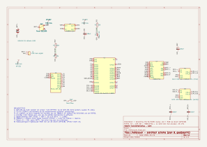

# Elektronisch

| Bestand | Wat | Openen |
|---|---|---|
| [elektrisch_schema.pdf](elektrisch_schema.pdf) | volledig schema (A4) | PDF, opent op GitHub |
| [elektrisch_schema.svg](elektrisch_schema.svg) | hetzelfde schema als afbeelding | browser |
| [boormal_1op1.pdf](boormal_1op1.pdf) / [png](boormal_1op1.png) | bovenzijde op schaal 1:1: plaats van elk onderdeel en elk boorgat | afdrukken op 100 % (A4) |
| [bekabelingsplan.pdf](bekabelingsplan.pdf) / [png](bekabelingsplan.png) | soldeerkant op schaal 2:1 met alle 48 draden genummerd | A3 |
| [draadlijst.md](draadlijst.md) | dezelfde 48 draden als afvinklijst per bouwstap | GitHub |
| [bedradingslijst.md](bedradingslijst.md) | verbindingen per onderdeel + controles vóór inschakelen | GitHub |
| [kicad/](kicad/readme.md) | KiCad 10-project van het schema | KiCad |
| [bekabelingsplan.py](bekabelingsplan.py) | maakt boormal, bekabelingsplan en draadlijst | `py -3 bekabelingsplan.py` |
| [easyeda_linefollower_planB.json](easyeda_linefollower_planB.json) | voorbeeldschema van de docent (Pro Micro, DRV8833), enkel ter referentie | EasyEDA |

## Overzicht

| Blok | Onderdeel | Aansluiting |
|---|---|---|
| Voeding | LiPo 2S 450 mAh → XT30 → SW1 (SS12D00) | VBAT 6,4–8,4 V |
| 3,3 V | CN3903-buck | ESP32, QTR-8A, TB6612-logica, encoders |
| Batterijmeting | 100 kΩ / 33 kΩ | GPIO9 |
| Sensor | QTR-8A | OUT1–8 → GPIO1–8, LEDON → GPIO11 |
| Motorsturing | TB6612FNG | PWMA/AIN1/AIN2 → 12/13/14, PWMB/BIN1/BIN2 → 15/16/17, STBY → 18 |
| Encoders | N20 Hall | links 39/40, rechts 41/42 |
| Bediening | start/stop-knop | GPIO21 (interne pull-up) |
| Status | ingebouwde RGB-led van de devkit | GPIO48 |

Dezelfde pinverdeling staat in [code/board.h](../../code/board.h).
