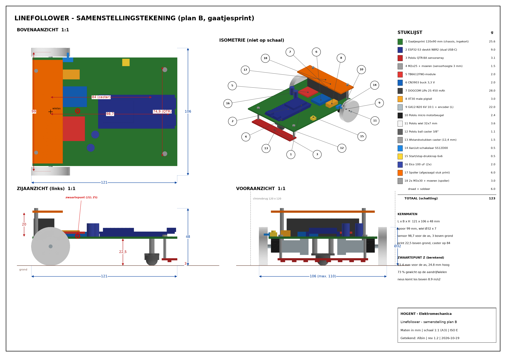

# Mechanisch



| Bestand | Wat | Openen |
|---|---|---|
| [tekening_linefollower.pdf](tekening_linefollower.pdf) / [png](tekening_linefollower.png) | samenstellingstekening A3: boven-, zij- en vooraanzicht, isometrie, stuklijst, kernmaten | PDF / afbeelding |
| [3d_iso_voor_links.png](3d_iso_voor_links.png), [3d_iso_achter_rechts.png](3d_iso_achter_rechts.png), [3d_iso_onder.png](3d_iso_onder.png) | 3D-renders | afbeelding |
| [3d/](3d/readme.md) | 3D-model per onderdeel (STL) + volledige samenstelling (STEP) | GitHub toont STL in 3D |
| [model_linefollower.py](model_linefollower.py) | maakt het 3D-model (build123d) | zie onderaan |
| [teken_aanzichten.py](teken_aanzichten.py) | maakt de tekening (schaal 1:1, positienummers, stuklijst met massa, zwaartepunt) en de renders uit de STL's | `py -3 teken_aanzichten.py` |
| [massa_zwaartepunt.txt](massa_zwaartepunt.txt) | berekende massa en gewichtsverdeling, ingelezen door de [simulatie](../../simulatie/readme.md) | tekst |

## Kernmaten

| | |
|---|---|
| L × B × H | 121 × 106 × 48 mm (chronobrug: max. 110 breed) |
| Print (chassis) | gaatjesprint 120 × 90 × 1,6 mm (ingekort van 150 mm) |
| Spoorbreedte | 99 mm (wielmidden) |
| Wielas | 16 mm boven de grond (wiel Ø32) |
| Bodemvrijheid print | 22,5 mm |
| Sensorlijn | 98,7 mm voor de wielas, 3 mm boven de grond |
| Ball caster | 84 mm voor de wielas, vlak achter de sensor (onder de ESP32) |
| Massa (schatting) | 123 g, zwaartepunt 22 mm voor de as en 25 mm hoog |
| Gewicht op de aandrijfwielen | 73 % (met de caster op 34 mm was dat maar 37 %) |
| Neus komt los | boven 8,9 m/s² versnelling |
| Batterij | dwars boven de wielas |
| Spoiler | afgezaagd stuk print 25 × 86 mm, 20 mm boven de print op 2× M3×30 |

## Maten van de onderdelen

Elk onderdeel heeft de maat van wat effectief besteld is. Alle maten staan in de tabel `MATEN` bovenaan in `model_linefollower.py`.

| Onderdeel | Maat (mm) | Bron |
|---|---|---|
| Pololu QTR-8A | 74,9 × 12,7 × 1,57; sensoren 9,525 uit elkaar; gaten Ø2,18 op 69,9 | Pololu-maattekening #960 |
| Pololu ball caster 3/8″ | 19,1 × 12,1; hoogte 10,1; kogel Ø9,53; gaten 13,5 uit elkaar | Pololu-maattekening #950 |
| Pololu wiel 32×7 | Ø32 × 7, D-as 3 mm | Pololu #1087 |
| Pololu motorbeugel | voor motoren 10 × 12 mm, M2/#2-bouten | Pololu #989 |
| GA12-N20 + encoder | 12 × 10; tandwielkast 9 + motor 15 + encoder 7; as Ø3 × 10 | typisch, **nameten** |
| ESP32-S3 devkit N8R2 | 63,5 × 28; pinrijen 25,4 uit elkaar | typisch, **nameten** |
| TB6612-module | 20,3 × 20,3 | typisch, **nameten** |
| CN3903-buck | 22 × 17 × 4 | typisch, **nameten** |
| LiPo DOGCOM 2S 450 mAh | 60 × 17 × 15 | typisch, **nameten** |
| Gaatjesprint | 90 × 150 × 1,6, raster 2,54 | bestelling |

De AliExpress-onderdelen hebben geen officiële maattekening. Meet ze na bij levering met de tabel in [instructable stap 3](../../instructable/readme.md). Pas het getal aan in `MATEN` en draai beide scripts opnieuw:

```
python model_linefollower.py      (Python met build123d: pip install build123d)
py -3 teken_aanzichten.py         (enkel numpy + matplotlib nodig)
```
